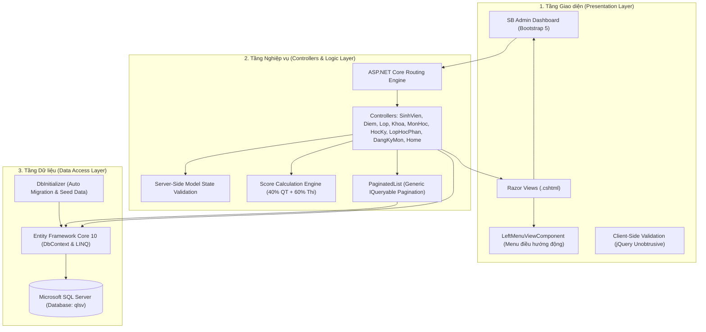
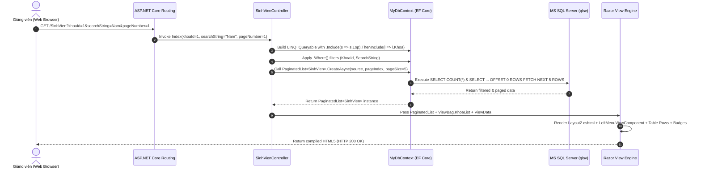
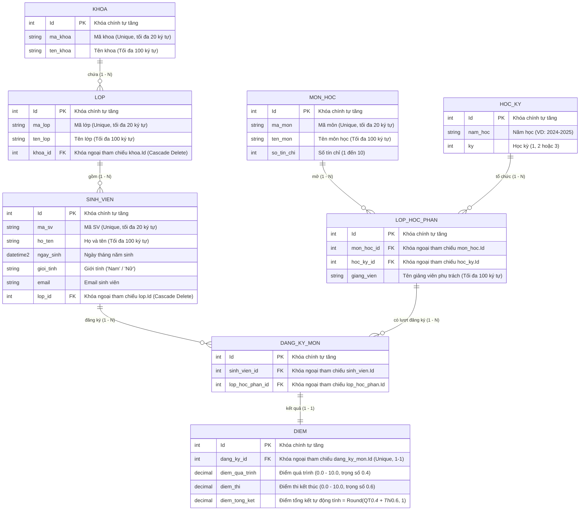

# HỆ THỐNG QUẢN LÝ ĐÀO TẠO & SINH VIÊN (QLSV) - UTC

> **Trường Đại học Giao thông Vận tải (UTC)**  
> **Khoa Công nghệ Thông tin - Bộ môn Khoa học Máy tính**  
> **Môn học**: Lập trình Web  
> **Nền tảng công nghệ**: ASP.NET Core MVC (.NET 10) | Entity Framework Core 10 | MS SQL Server | SB Admin Dashboard  
> **Đối tượng sử dụng duy nhất (Actor)**: **Giảng viên / Cán bộ quản lý đào tạo**

---

## MỤC LỤC
1. [Giới thiệu tổng quan dự án](#1-giới-thiệu-tổng-quan-dự-án)
2. [Ngăn xếp công nghệ (Tech Stack)](#2-ngăn-xếp-công-nghệ-tech-stack)
3. [Kiến trúc hệ thống & Luồng xử lý](#3-kiến-trúc-hệ-thống--luồng-xử-lý)
4. [Mô hình dữ liệu (Database Schema & ERD)](#4-mô-hình-dữ-liệu-database-schema--erd)
5. [Chi tiết các Phân hệ chức năng (Modules)](#5-chi-tiết-các-phân-hệ-chức-năng-modules)
6. [Các kỹ thuật và cơ chế nổi bật trong Source Code](#6-các-kỹ-thuật-và-cơ-chế-nổi-bật-trong-source-code)
7. [Cấu trúc thư mục Source Code](#7-cấu-trúc-thư-mục-source-code)
8. [Hướng dẫn cài đặt & Khởi chạy hệ thống](#8-hướng-dẫn-cài-đặt--khởi-chạy-hệ-thống)
9. [Kịch bản kiểm thử (Test Cases)](#9-kịch-bản-kiểm-thử-test-cases)
10. [Tổng kết & Đánh giá đồ án](#10-tổng-kết--đánh-giá-đồ-án)

---

## 1. GIỚI THIỆU TỔNG QUAN DỰ ÁN

### 1.1. Bối cảnh & Mục tiêu
Dự án **Quản lý Đào tạo & Sinh viên (QLSV)** được xây dựng nhằm tin học hóa và tự động hóa quy trình quản lý học vụ tại các khoa/viện đào tạo của Trường Đại học Giao thông Vận tải (UTC). Hệ thống thay thế phương thức quản lý thủ công rời rạc bằng bảng tính Excel, giúp giảm thiểu sai sót, chống trùng lặp dữ liệu và tập trung hóa toàn bộ chu trình đào tạo: từ quản lý cơ cấu Khoa - Lớp - Sinh viên, lập kế hoạch Môn học - Học kỳ - Lớp học phần, cho đến Đăng ký học phần và Tính điểm học tập tự động.

### 1.2. Phạm vi & Tác nhân sử dụng (Actor)
* **Tác nhân duy nhất (Single Actor)**: **Giảng viên / Cán bộ quản lý đào tạo**.
* **Đặc tính phân quyền**: Toàn bộ luồng nghiệp vụ trên hệ thống được thiết kế chuyên biệt phục vụ thao tác của Giảng viên. Không triển khai luồng dành cho Khách vãng lai và Sinh viên tra cứu ngoài lề, đảm bảo tính tập trung, an toàn dữ liệu và đúng trọng tâm đồ án quản trị.

---

## 2. NGĂN XẾP CÔNG NGHỆ (TECH STACK)

| Thành phần | Công nghệ / Thư viện | Phiên bản | Vai trò trong hệ thống |
| :--- | :--- | :---: | :--- |
| **Backend Framework** | ASP.NET Core MVC | **.NET 10.0** | Framework web hiệu năng cao, xử lý nghiệp vụ theo mô hình Model-View-Controller. |
| **ORM** | Entity Framework Core | **10.0.9** | Object-Relational Mapping (Code-First), ánh xạ thực thể C# thành bảng trong SQL Server, hỗ trợ LINQ query. |
| **Cơ sở dữ liệu** | Microsoft SQL Server | 2019 / 2022 / LocalDB | Hệ quản trị CSDL quan hệ, lưu trữ toàn bộ 8 bảng dữ liệu học vụ với ràng buộc toàn vẹn quan hệ. |
| **Giao diện (Frontend)** | SB Admin Dashboard + Bootstrap | **Bootstrap 5.3** | Bộ giao diện quản trị responsive hiện đại, sidebar cố định, bảng dữ liệu chuẩn hóa, icons FontAwesome 6. |
| **Client Validation** | jQuery & jQuery Validation Unobtrusive | 3.6.0 | Kiểm tra dữ liệu trực tiếp trên trình duyệt theo Data Annotations trước khi gửi request về server. |
| **Công cụ phát triển** | Visual Studio 2022 / VS Code / .NET 10 CLI | Latest | Môi trường lập trình, build và debug. |

---

## 3. KIẾN TRÚC HỆ THỐNG & LUỒNG XỬ LÝ

### 3.1. Sơ đồ kiến trúc 3 tầng (3-Tier MVC Architecture)



### 3.2. Luồng xử lý một Request nghiệp vụ (Request Lifecycle)



---

## 4. MÔ HÌNH DỮ LIỆU (DATABASE SCHEMA & ERD)

### 4.1. Sơ đồ thực thể quan hệ (ERD)



### 4.2. Từ điển dữ liệu chi tiết 8 bảng (Data Dictionary)

#### 1. Bảng `khoa` (`Khoa.cs`)
* `Id` (`int`, PK, Identity): Mã định danh khoa.
* `ma_khoa` (`nvarchar(20)`, Not Null): Mã viết tắt khoa (VD: CNTT, KTVT, DDT, CTGT).
* `ten_khoa` (`nvarchar(100)`, Not Null): Tên đầy đủ của khoa (VD: Công nghệ thông tin).

#### 2. Bảng `lop` (`Lop.cs`)
* `Id` (`int`, PK, Identity): Mã định danh lớp niên chế.
* `ma_lop` (`nvarchar(20)`, Not Null): Mã lớp (VD: CNTT1, KT1, CD1).
* `ten_lop` (`nvarchar(100)`, Not Null): Tên lớp (VD: CNTT 1 - K62).
* `khoa_id` (`int`, FK -> `khoa.Id`, Not Null): Khoa trực thuộc (Cascade Delete).

#### 3. Bảng `sinh_vien` (`SinhVien.cs`)
* `Id` (`int`, PK, Identity): Mã định danh sinh viên.
* `ma_sv` (`nvarchar(20)`, Not Null): Mã sinh viên duy nhất (VD: SV001, SV002).
* `ho_ten` (`nvarchar(100)`, Not Null): Họ và tên đầy đủ của sinh viên.
* `ngay_sinh` (`datetime2`, Not Null): Ngày tháng năm sinh.
* `gioi_tinh` (`nvarchar(10)`, Not Null): Giới tính ("Nam" / "Nữ").
* `email` (`nvarchar(100)`, EmailAddress): Địa chỉ thư điện tử.
* `lop_id` (`int`, FK -> `lop.Id`, Not Null): Lớp sinh hoạt (Cascade Delete).

#### 4. Bảng `mon_hoc` (`MonHoc.cs`)
* `Id` (`int`, PK, Identity): Mã định danh môn học.
* `ma_mon` (`nvarchar(20)`, Not Null): Mã môn học (VD: IT101, IT401).
* `ten_mon` (`nvarchar(100)`, Not Null): Tên môn học (VD: Lập trình Web nâng cao (.NET)).
* `so_tin_chi` (`int`, Not Null, Range 1 - 10): Số tín chỉ đào tạo.

#### 5. Bảng `hoc_ky` (`HocKy.cs`)
* `Id` (`int`, PK, Identity): Mã định danh học kỳ.
* `nam_hoc` (`nvarchar(20)`, Not Null): Niên khóa đào tạo (VD: "2024-2025").
* `ky` (`int`, Not Null, Range 1 - 3): Kỳ học trong năm (1: Kỳ I, 2: Kỳ II, 3: Kỳ hè).

#### 6. Bảng `lop_hoc_phan` (`LopHocPhan.cs`)
* `Id` (`int`, PK, Identity): Mã định danh lớp học phần mở trong kỳ.
* `mon_hoc_id` (`int`, FK -> `mon_hoc.Id`, Not Null): Môn học tổ chức.
* `hoc_ky_id` (`int`, FK -> `hoc_ky.Id`, Not Null): Học kỳ mở lớp.
* `giang_vien` (`nvarchar(100)`, Not Null): Tên giảng viên chịu trách nhiệm giảng dạy.

#### 7. Bảng `dang_ky_mon` (`DangKyMon.cs`)
* `Id` (`int`, PK, Identity): Mã định danh bản ghi đăng ký.
* `sinh_vien_id` (`int`, FK -> `sinh_vien.Id`, Not Null): Sinh viên được đăng ký học.
* `lop_hoc_phan_id` (`int`, FK -> `lop_hoc_phan.Id`, Not Null): Lớp học phần được gán.

#### 8. Bảng `diem` (`Diem.cs`)
* `Id` (`int`, PK, Identity): Mã định danh kết quả học tập.
* `dang_ky_id` (`int`, FK -> `dang_ky_mon.Id`, Not Null, Unique): Bản ghi đăng ký tương ứng (Quan hệ 1-1).
* `diem_qua_trinh` (`decimal(18,2)`, Nullable, Range 0 - 10): Điểm chuyên cần và kiểm tra định kỳ (hệ số 0.4).
* `diem_thi` (`decimal(18,2)`, Nullable, Range 0 - 10): Điểm thi kết thúc học phần (hệ số 0.6).
* `diem_tong_ket` (`decimal(18,2)`, Nullable, Range 0 - 10): Điểm tổng kết môn được tự động tính và làm tròn 1 chữ số thập phân.

---

## 5. CHI TIẾT CÁC PHÂN HỆ CHỨC NĂNG (MODULES)

### 5.1. Bảng ma trận định tuyến URL (Route Mapping)

| Phân hệ (Module) | Controller | Action & Phương thức | Đường dẫn URL | Mô tả chức năng & Nghiệp vụ |
| :--- | :--- | :--- | :--- | :--- |
| **Dashboard** | `HomeController` | `GET Index` | `/` hoặc `/Home/Index` | Hiển thị 4 thẻ thống kê tổng quan (Tổng số Khoa, Lớp, Sinh viên, Môn học). |
| **Quản lý Khoa** | `KhoaController` | `GET Index`<br>`GET/POST Create`<br>`GET/POST Edit`<br>`GET Details`<br>`GET/POST Delete` | `/Khoa`<br>`/Khoa/Create`<br>`/Khoa/Edit/{id}`<br>`/Khoa/Details/{id}`<br>`/Khoa/Delete/{id}` | Quản lý danh mục các Khoa đào tạo. Hỗ trợ tìm kiếm theo tên/mã khoa, phân trang danh sách. |
| **Quản lý Lớp** | `LopController` | `GET Index`<br>`GET/POST Create`<br>`GET/POST Edit`<br>`GET Details`<br>`GET/POST Delete` | `/Lop`<br>`/Lop/Create`<br>`/Lop/Edit/{id}`<br>`/Lop/Details/{id}`<br>`/Lop/Delete/{id}` | Quản lý danh sách Lớp sinh hoạt. Lọc lớp theo Khoa, dropdown chọn Khoa khi thêm mới/chỉnh sửa. |
| **Quản lý Sinh viên** | `SinhVienController` | `GET Index`<br>`GET/POST Create`<br>`GET/POST Edit`<br>`GET Details`<br>`GET/POST Delete` | `/SinhVien`<br>`/SinhVien/Create`<br>`/SinhVien/Edit/{id}`<br>`/SinhVien/Details/{id}`<br>`/SinhVien/Delete/{id}` | Phân hệ hạt nhân. Đa bộ lọc (Khoa, Lớp, Giới tính), tìm kiếm đa trường (Mã SV, Họ tên, Email), phân trang 5 SV/trang, validate trùng Mã SV. |
| **Quản lý Môn học** | `MonHocController` | `GET Index`<br>`GET/POST Create`<br>`GET/POST Edit`<br>`GET Details`<br>`GET/POST Delete` | `/MonHoc`<br>`/MonHoc/Create`<br>`/MonHoc/Edit/{id}`<br>`/MonHoc/Details/{id}`<br>`/MonHoc/Delete/{id}` | Quản lý danh mục môn đào tạo, số tín chỉ (1 - 10). Lọc môn theo số tín chỉ, tìm kiếm theo tên môn. |
| **Quản lý Học kỳ** | `HocKyController` | `GET Index`<br>`GET/POST Create`<br>`GET/POST Edit`<br>`GET Details`<br>`GET/POST Delete` | `/HocKy`<br>`/HocKy/Create`<br>`/HocKy/Edit/{id}`<br>`/HocKy/Details/{id}`<br>`/HocKy/Delete/{id}` | Quản lý Niên khóa (VD: 2024-2025) và Học kỳ (Kỳ 1, 2, 3 hè). Tìm kiếm theo năm học. |
| **Lớp học phần** | `LopHocPhanController` | `GET Index`<br>`GET/POST Create`<br>`GET/POST Edit`<br>`GET Details`<br>`GET/POST Delete` | `/LopHocPhan`<br>`/LopHocPhan/Create`<br>`/LopHocPhan/Edit/{id}`<br>`/LopHocPhan/Details/{id}`<br>`/LopHocPhan/Delete/{id}` | Mở lớp tín chỉ theo từng Học kỳ và Môn học. Gán Giảng viên phụ trách, tìm kiếm theo tên giảng viên. |
| **Đăng ký môn** | `DangKyMonController` | `GET Index`<br>`GET/POST Create`<br>`GET/POST Edit`<br>`GET Details`<br>`GET/POST Delete` | `/DangKyMon`<br>`/DangKyMon/Create`<br>`/DangKyMon/Edit/{id}`<br>`/DangKyMon/Details/{id}`<br>`/DangKyMon/Delete/{id}` | Giảng viên ghi danh sinh viên vào Lớp học phần. Tìm kiếm theo tên/mã SV, chống trùng lặp ghi danh. |
| **Quản lý Điểm** | `DiemController` | `GET Index`<br>`GET/POST Create`<br>`GET/POST Edit`<br>`GET Details`<br>`GET/POST Delete` | `/Diem`<br>`/Diem/Create`<br>`/Diem/Edit/{id}`<br>`/Diem/Details/{id}`<br>`/Diem/Delete/{id}` | Nhập điểm Quá trình và Điểm thi. Tự động tính Điểm tổng kết: `Math.Round(diemQT * 0.4 + diemThi * 0.6, 1)`. Chống nhập đè bản ghi. |
| **Tính GPA & Xếp loại** | `GpaController` | `GET Index`<br>`GET Details/{id}` | `/Gpa`<br>`/Gpa/Details/{id}` | Tính Điểm tổng kết, GPA theo học kỳ, GPA tích lũy toàn khóa (Hệ 10 & Hệ 4), tự động xếp loại học lực (Xuất sắc, Giỏi, Khá, Trung bình, Yếu), hỗ trợ đa bộ lọc và phân trang. |
| **Legacy Lab 1** | `StudentController` | `GET Index`<br>`GET/POST Create` | `/Student`<br>`/Student/Create` | Module quản lý sinh viên mẫu lưu trữ trong RAM (static list) từ bài thực hành Lab 1. |

---

## 6. CÁC KỸ THUẬT VÀ CƠ CHẾ NỔI BẬT TRONG SOURCE CODE

### 6.1. Khởi tạo Cơ sở Dữ liệu & Seed Data tự động (`DbInitializer.cs`)
Hệ thống không yêu cầu người dùng phải tự chạy file script `.sql` phức tạp. Trong [`Program.cs`](file:///c:/Users/ADMIN/OneDrive/Desktop/Lap_trinh_Web_UTC/Lab/Lab2/Lab2/Program.cs), ứng dụng kích hoạt scope tự động:
```csharp
using (var scope = app.Services.CreateScope())
{
    var services = scope.ServiceProvider;
    DbInitializer.Initialize(services);
}
```
* Hàm `context.Database.EnsureCreated()` tự động tạo toàn bộ bảng trong SQL Server nếu database chưa tồn tại.
* Nếu bảng `khoa` trống, hệ thống tự nạp ngay:
  * **4 Khoa mẫu**: CNTT, Kinh tế vận tải, Điện - Điện tử, Công trình giao thông.
  * **6 Lớp mẫu**: CNTT1-K62, CNTT2-K62, KT1-K62, KT2-K62, DT1-K62, CD1-K62.
  * **12 Sinh viên mẫu**: Có đầy đủ MSSV, họ tên, ngày sinh, email chuẩn UTC.
  * **8 Môn học mẫu**: C/C++, Cấu trúc dữ liệu & Giải thuật, CSDL, Lập trình Web nâng cao (.NET),...

### 6.2. Phân trang Generic tối ưu hóa SQL Server (`PaginatedList<T>`)
Thay vì dùng `.ToList()` tải hàng chục nghìn bản ghi vào RAM rồi mới cắt trang, lớp generic [`PaginatedList<T>`](file:///c:/Users/ADMIN/OneDrive/Desktop/Lap_trinh_Web_UTC/Lab/Lab2/Lab2/Models/PaginatedList.cs) can thiệp trực tiếp vào câu lệnh SQL của EF Core:
```csharp
public static async Task<PaginatedList<T>> CreateAsync(IQueryable<T> source, int pageIndex, int pageSize)
{
    var count = await source.CountAsync(); // COUNT(*) trên SQL Server
    var items = await source.Skip((pageIndex - 1) * pageSize).Take(pageSize).ToListAsync(); // OFFSET - FETCH
    return new PaginatedList<T>(items, count, pageIndex, pageSize);
}
```

### 6.3. Duy trì trạng thái Bộ lọc & Phân trang qua URL Parameters
Khi chuyển giữa các trang, tham số tìm kiếm và bộ lọc không bị mất nhờ truyền liên tục vào Tag Helper:
```html
<a class="page-link" asp-action="Index"
   asp-route-pageNumber="@(Model.PageIndex + 1)"
   asp-route-khoaId="@ViewData["CurrentKhoaId"]"
   asp-route-lopId="@ViewData["CurrentLopId"]"
   asp-route-gioiTinh="@ViewData["CurrentGioiTinh"]"
   asp-route-searchString="@ViewData["CurrentFilter"]">
   Trang sau
</a>
```
Đồng thời, các dropdown lọc đều có `onchange="this.form.submit()"` giúp giao diện tự động reload kết quả ngay khi chọn.

### 6.4. Cơ chế Kiểm tra tính hợp lệ dữ liệu 2 lớp (Dual-layer Validation)
1. **Phía Client**: Sử dụng các thuộc tính `[Required]`, `[StringLength]`, `[Range]`, `[EmailAddress]` của Data Annotations kết hợp với thư viện `jquery.validate.unobtrusive.js` để thông báo lỗi tức thì khi người dùng gõ sai, không cần reload trang.
2. **Phía Server**: Kiểm tra `ModelState.IsValid` và thực thi các logic nghiệp vụ phức tạp như:
   * Kiểm tra trùng mã sinh viên: `await _context.SinhViens.AnyAsync(s => s.MaSv == sinhVien.MaSv)`
   * Kiểm tra bản ghi đăng ký môn đã có điểm hay chưa để tránh ghi đè kết quả.

### 6.5. Tự động tính điểm học phần theo công thức chuẩn
Trong [`DiemController.cs`](file:///c:/Users/ADMIN/OneDrive/Desktop/Lap_trinh_Web_UTC/Lab/Lab2/Lab2/Controllers/DiemController.cs):
```csharp
if (diem.DiemQuaTrinh.HasValue && diem.DiemThi.HasValue)
{
    // Tự động tính điểm tổng kết: 40% quá trình + 60% thi cuối kỳ
    diem.DiemTongKet = Math.Round(diem.DiemQuaTrinh.Value * 0.4m + diem.DiemThi.Value * 0.6m, 1);
}
```

### 6.6. ViewComponent xây dựng Menu điều hướng động
Sử dụng `LeftMenuViewComponent` (`ViewComponents/LeftMenuViewComponent.cs`) kết hợp với template `Views/Shared/Components/LeftMenu/Menu.cshtml` để render thanh điều hướng bên trái một cách linh hoạt, độc lập, không làm phình to file layout chính.

---

## 7. CẤU TRÚC THƯ MỤC SOURCE CODE

```text
Lab2/
├── Controllers/                             # Các Controller tiếp nhận và xử lý HTTP Request
│   ├── HomeController.cs                   # Thống kê số liệu Dashboard
│   ├── KhoaController.cs                   # CRUD, tìm kiếm, phân trang Khoa
│   ├── LopController.cs                    # CRUD, lọc theo Khoa, phân trang Lớp
│   ├── SinhVienController.cs               # Đa bộ lọc (Khoa, Lớp, Phái), Search, CRUD Sinh viên
│   ├── MonHocController.cs                # CRUD, lọc tín chỉ, phân trang Môn học
│   ├── HocKyController.cs                 # CRUD, tìm kiếm năm học, phân trang Học kỳ
│   ├── LopHocPhanController.cs            # CRUD, gán giảng viên, phân trang Lớp học phần
│   ├── DangKyMonController.cs             # Ghi danh sinh viên vào lớp học phần
│   ├── DiemController.cs                  # Nhập điểm, tự động tính tổng kết (40% - 60%)
│   └── StudentController.cs               # Module Lab 1 (danh sách sinh viên trong RAM)
│
├── Models/
│   ├── Data/
│   │   ├── MyDbContext.cs                 # DbContext EF Core 10 ánh xạ 8 bảng & Fluent API Cascade
│   │   └── DbInitializer.cs               # Khởi tạo CSDL và nạp 4 Khoa, 6 Lớp, 12 SV, 8 Môn mẫu
│   ├── Entities/                          # Các lớp thực thể POCO ánh xạ CSDL
│   │   ├── Khoa.cs                        # Thực thể Khoa (khoa)
│   │   ├── Lop.cs                         # Thực thể Lớp (lop)
│   │   ├── SinhVien.cs                    # Thực thể Sinh viên (sinh_vien)
│   │   ├── MonHoc.cs                      # Thực thể Môn học (mon_hoc)
│   │   ├── HocKy.cs                       # Thực thể Học kỳ (hoc_ky)
│   │   ├── LopHocPhan.cs                  # Thực thể Lớp học phần (lop_hoc_phan)
│   │   ├── DangKyMon.cs                   # Thực thể Đăng ký môn (dang_ky_mon)
│   │   └── Diem.cs                        # Thực thể Điểm số (diem)
│   ├── PaginatedList.cs                   # Class generic hỗ trợ phân trang LINQ IQueryable
│   ├── ErrorViewModel.cs                  # Model hiển thị trang lỗi hệ thống
│   ├── Student.cs / Branch.cs / Gender.cs # Models phục vụ module Lab 1
│   └── Menultem.cs                        # Model cấu trúc menu điều hướng
│
├── ViewComponents/
│   └── LeftMenuViewComponent.cs           # ViewComponent nạp menu thanh điều hướng bên trái
│
├── Views/                                 # Giao diện Razor (.cshtml)
│   ├── Home/                              # Index.cshtml (Dashboard tổng quan các card số liệu)
│   ├── Khoa/                              # Index, Create, Edit, Details, Delete (Khoa)
│   ├── Lop/                               # Index, Create, Edit, Details, Delete (Lớp)
│   ├── SinhVien/                          # Index, Create, Edit, Details, Delete (Sinh viên)
│   ├── MonHoc/                            # Index, Create, Edit, Details, Delete (Môn học)
│   ├── HocKy/                             # Index, Create, Edit, Details, Delete (Học kỳ)
│   ├── LopHocPhan/                        # Index, Create, Edit, Details, Delete (Lớp học phần)
│   ├── DangKyMon/                         # Index, Create, Edit, Details, Delete (Đăng ký môn)
│   ├── Diem/                              # Index, Create, Edit, Details, Delete (Điểm)
│   ├── Student/                           # Giao diện Lab 1
│   └── Shared/                            # Giao diện dùng chung
│       ├── Layout2.cshtml                 # Layout chính SB Admin Dashboard
│       ├── _Layout.cshtml                 # Layout phụ Bootstrap mặc định
│       ├── TopNav.cshtml                  # Thanh điều hướng phía trên
│       ├── LeftMenu.cshtml                # Partial menu dự phòng
│       ├── Footer.cshtml                  # Chân trang bản quyền UTC
│       ├── _ValidationScriptsPartial.cshtml # Script validation client
│       └── Components/LeftMenu/Menu.cshtml# View hiển thị của LeftMenuViewComponent
│
├── wwwroot/                               # Tài nguyên tĩnh phía Client
│   ├── css/css/styles.css                 # File style chuẩn của theme SB Admin
│   ├── js/js/scripts.js                   # Script điều khiển đóng mở Sidebar SB Admin
│   ├── lib/bootstrap/                     # Thư viện Bootstrap 5
│   └── lib/jquery/                        # Thư viện jQuery và jQuery Validation
│
├── docs/                                  # Tài liệu chi tiết dự án & Báo cáo
│   ├── Lập Trình WEB.docx                 # Báo cáo đồ án chính thức (Word format đã format chuẩn)
│   ├── Lập Trình WEB_backup.docx          # Bản sao lưu gốc của báo cáo
│   ├── PROJECT_DOCUMENTATION.md           # Tài liệu kỹ thuật chi tiết toàn bộ dự án
│   ├── WORKFLOW.md                        # Tài liệu quy trình & sơ đồ kiến trúc
│   └── 1_MODULE_KHOA.md -> 8_MODULE_DIEM.md # Tài liệu chi tiết từng phân hệ riêng lẻ
│
├── appsettings.json                       # Cấu hình chuỗi kết nối SQL Server (qlsv)
├── Program.cs                             # Điểm khởi chạy ứng dụng, DI & Middleware pipeline
└── Lab2.csproj                            # Cấu hình project .NET 10 & các NuGet package
```

---

## 8. HƯỚNG DẪN CÀI ĐẶT & KHỞI CHẠY HỆ THỐNG

### 8.1. Yêu cầu môi trường
* **.NET 10 SDK** (hoặc mới hơn). Kiểm tra bằng lệnh: `dotnet --version`.
* **Microsoft SQL Server** (bản 2017, 2019, 2022 hoặc LocalDB). Dịch vụ SQL Server đang chạy (`Running`).

### 8.2. Cấu hình Chuỗi kết nối CSDL (Connection String)
Mở tệp [`appsettings.json`](file:///c:/Users/ADMIN/OneDrive/Desktop/Lap_trinh_Web_UTC/Lab/Lab2/Lab2/appsettings.json) và chỉnh sửa thông tin tài khoản SQL Server phù hợp với máy tính của bạn:
```json
{
  "ConnectionStrings": {
    "qlsv": "Server=localhost;Database=qlsv;User Id=sa;Password=123456;TrustServerCertificate=True;MultipleActiveResultSets=True;"
  }
}
```
*(Nếu dùng Windows Authentication, có thể đổi thành `Server=localhost;Database=qlsv;Trusted_Connection=True;TrustServerCertificate=True;`)*

### 8.3. Khởi chạy ứng dụng
1. Mở cửa sổ Terminal / PowerShell tại thư mục gốc của dự án (`Lab2`):
   ```powershell
   dotnet run
   ```
2. Mở trình duyệt và truy cập vào cổng HTTP/HTTPS hiển thị trên console:
   * Ví dụ: `http://localhost:5202` hoặc `https://localhost:7080`
3. Hệ thống sẽ **tự động khởi tạo database `qlsv`** và chèn sẵn dữ liệu mẫu (Khoa, Lớp, Sinh viên, Môn học) thông qua `DbInitializer`. Bạn có thể sử dụng ngay mà không cần chạy bất kỳ lệnh migration nào thủ công.

---

## 9. KỊCH BẢN KIỂM THỬ (TEST CASES)

| Mã TC | Phân hệ kiểm thử | Hành động kiểm thử | Dữ liệu đầu vào | Kết quả mong đợi | Trạng thái |
| :---: | :--- | :--- | :--- | :--- | :---: |
| **TC01** | `DbInitializer` | Khởi chạy ứng dụng lần đầu | Chuỗi kết nối SQL Server hợp lệ | Tự động tạo CSDL `qlsv` và 8 bảng. Nạp thành công 4 Khoa, 6 Lớp, 12 SV, 8 Môn học. | **ĐẠT (PASS)** |
| **TC02** | `SinhVien` | Kiểm tra Validation khi thêm mới | Để trống Mã SV hoặc Họ tên | Báo lỗi đỏ ngay trên giao diện (Client & Server Validation). Không lưu vào CSDL. | **ĐẠT (PASS)** |
| **TC03** | `SinhVien` | Kiểm tra chống trùng khóa chính | Nhập Mã SV = "SV001" (đã có) | Hiển thị thông báo *"Mã sinh viên đã tồn tại"*. Ngăn chặn chèn dữ liệu trùng. | **ĐẠT (PASS)** |
| **TC04** | `SinhVien` | Đa bộ lọc và Tìm kiếm kết hợp | Chọn Khoa = "CNTT", Lớp = "CNTT1", Từ khóa = "Nam" | Danh sách tự động lọc ra đúng sinh viên "Nguyễn Hải Nam" thuộc lớp CNTT1. | **ĐẠT (PASS)** |
| **TC05** | `SinhVien` | Phân trang danh sách | Bấm chọn nút "Trang sau" (Trang 2) | Hiển thị 5 sinh viên tiếp theo, các query params bộ lọc trên URL vẫn được bảo lưu trọn vẹn. | **ĐẠT (PASS)** |
| **TC06** | `Diem` | Tự động tính điểm học phần | Nhập Điểm QT = 8.0, Điểm Thi = 7.0 | Hệ thống tự động tính: $8.0 \times 0.4 + 7.0 \times 0.6 = 7.4$. Lưu Điểm tổng kết = 7.4. | **ĐẠT (PASS)** |
| **TC07** | `Khoa / Lop` | Kiểm tra toàn vẹn Cascade Delete | Xóa một Lớp học đang có Sinh viên | Các sinh viên và đăng ký môn trực thuộc lớp đó được dọn dẹp an toàn theo cấu hình Fluent API. | **ĐẠT (PASS)** |

---

## 10. TỔNG KẾT & ĐÁNH GIÁ ĐỒ ÁN
Dự án **Quản lý Đào tạo & Sinh viên (QLSV)** của Nhóm 05 đã hoàn thành toàn diện mục tiêu môn học Lập trình Web:
1. **Kiến trúc hiện đại**: Vận dụng chuẩn mô hình ASP.NET Core MVC trên nền tảng .NET 10 mới nhất.
2. **Quản trị dữ liệu chặt chẽ**: 8 thực thể quan hệ phản ánh sát thực tế quản lý đào tạo tín chỉ tại trường đại học.
3. **Hiệu năng cao**: Tối ưu hóa truy vấn bằng `AsNoTracking()`, phân trang tầng CSDL `Skip/Take`, và ViewComponent động.
4. **Trải nghiệm người dùng chuyên nghiệp**: Tích hợp giao diện quản trị SB Admin trực quan, responsive và thân thiện với thao tác của Giảng viên.

---
*Tài liệu được biên soạn và cập nhật đồng bộ trực tiếp với Source Code dự án.*
